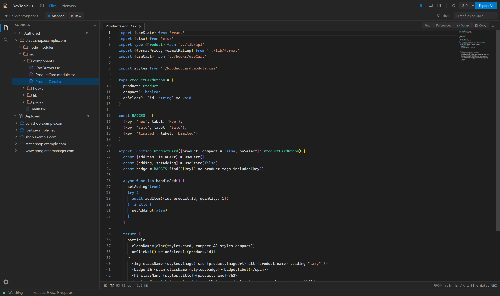

# DevTools++

An alternative source and network workspace inside Chrome DevTools for debugging,
reverse engineering, and inspecting web pages.

I built it because Chromium's DevTools was missing features I'd wanted for a while,
starting with exporting files detected through source maps. I've tried to keep the
familiar DevTools behavior first, then add new features and quality-of-life improvements.

## Features

- Source inspection
  - [ZIP and TAR exports](docs/exporting.md)
    - Source-mapped and raw files, folders, domains, or whole captures
  - [Source filter](docs/usage.md#filter-and-group-files) with include/exclude rules and grouping by domain or file type
  - [Monaco code editor](docs/editor.md)
    - Basic code completion, go to definition, and find references
    - Syntax highlighting and [configurable formatting](docs/settings.md#code-formatting)
    - Minimap navigation and [editor options](docs/settings.md#editor-monaco) in Settings
  - [Search across all captured files](docs/editor.md#editing-and-search)
- [Network request inspection](docs/network.md)
  - [Filtering](docs/network.md#filters), sorting, and request timestamps
  - Headers, payloads, responses, cookies, and timing details
    - Source and parsed body views, sandboxed previews, and a [hex viewer](docs/network.md#detail-views) with a data inspector
  - [Copy as](docs/network.md#copy-as-code) Python (requests or httpx), browser/Node.js fetch, PowerShell, or cURL
    - Copy or export multiple selected requests
    - [Preferred replay format, line width, and embedded JSON style](docs/settings.md#network) in Settings
  - [Initiator](docs/network.md#initiator) call stacks with source navigation
- Workspace customization
  - Dockable panels and [alternative themes](docs/settings.md#color-theme)
  - VS Code-style command palette and [searchable settings](docs/settings.md)

## Install

1. Download and unzip [the latest build](https://github.com/stugmi/SourceExporter/releases/download/latest/devtools-plus-plus.zip).
2. Open `chrome://extensions` and enable **Developer mode**.
3. Click **Load unpacked** and select the extracted folder.

To build from source, see [development](docs/development.md).

## Quick start

1. Open DevTools on the page you want to inspect and select **DevTools++**.
2. Reload the page if its scripts loaded before the panel was open.
3. Select a file or request to inspect it, then use **Export All** to save the capture.

## Documentation

- [Capture and filtering](docs/usage.md)
- [Exporting files and requests](docs/exporting.md)
- [Editor and keyboard shortcuts](docs/editor.md)
- [Network requests](docs/network.md)
- [Settings](docs/settings.md)
- [Development](docs/development.md)
- [How it works](docs/architecture.md)
- [Changelog](CHANGELOG.md)
