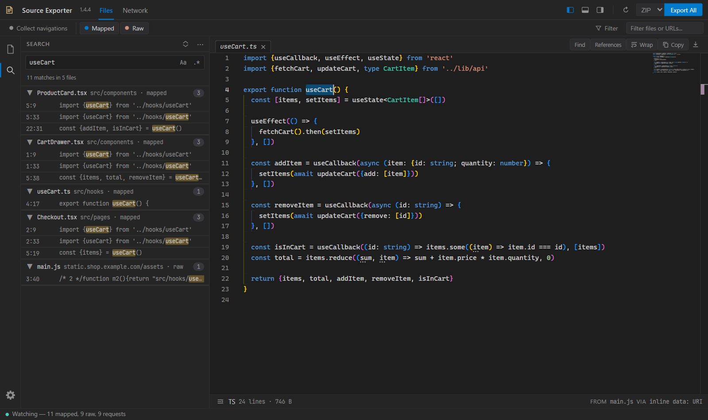
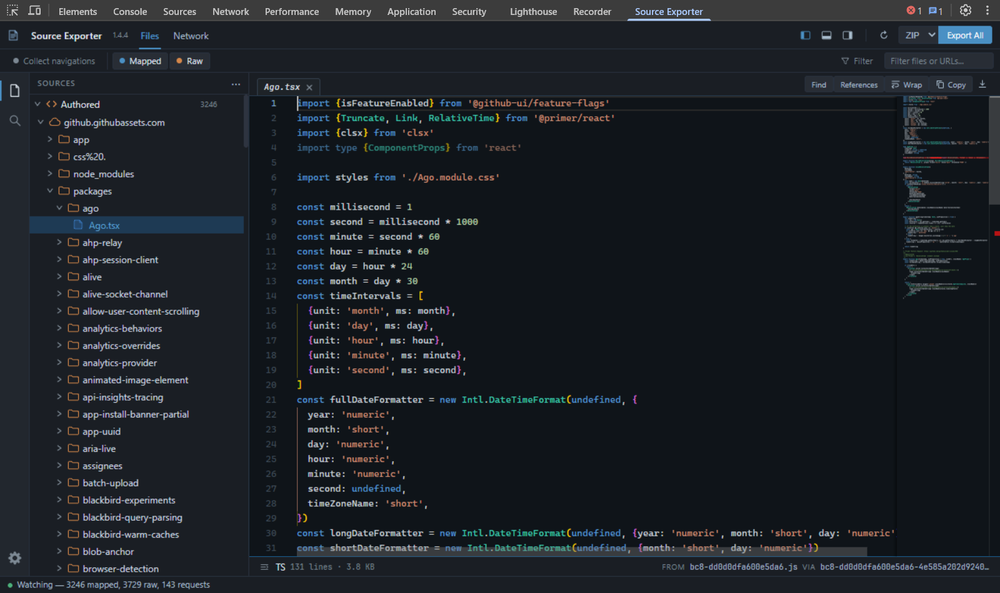

# Editor and keyboard shortcuts

Open a file from the tree to edit it with Monaco syntax highlighting, completion, bracket guides, and a minimap.

## Editing and search

Edited tabs have a dot beside their name. Copy and Export use the edited content.

**Find** searches the current file. **Search all** shows grouped, live results across captured files with highlighted context; selecting a result jumps to the exact match. Pretty-formatting can be toggled for the open file or request body, or turned on for every preview with [Pretty-format previews by default](settings.md#pretty-format-previews-by-default). Indentation, brace and object layout, blank lines, and line wrapping are set in **Settings > [Code Formatting](settings.md#code-formatting)**; the default [Smart brace style](settings.md#braces-and-objects) keeps short imports and objects on one line in files that are already formatted and fully expands minified code.

Hold **Ctrl** and click a symbol to jump to its closest preceding declaration or assignment. **References** lists matches across captured website files.

## Layout and commands

The left sidebar, bottom panel, and right sidebar can be toggled independently. The command palette opens commands and [Settings](settings.md) by name: boolean settings such as Sticky Scroll toggle directly, while other settings open in the Settings window.

Choose a [color theme](settings.md#color-theme) in **Settings > Appearance**: VS Dark (default), DevTools Dark, Dark (Navy / Charcoal), VS Light, Light, and high contrast dark or light. The theme applies to the whole panel and the editor.

## Keyboard shortcuts

Shortcuts apply while the Source Exporter panel has focus. Definitions live in [`keybinds.js`](../src/panel/js/core/keybinds.js).

| Keys                 | Action                                                                           |
| -------------------- | -------------------------------------------------------------------------------- |
| Ctrl+F               | Find in the current file                                                         |
| Ctrl+Shift+F         | Search all captured files                                                        |
| Shift+Alt+F          | Toggle pretty-formatting                                                         |
| Ctrl+P               | Open a captured file by name                                                     |
| Ctrl+Shift+P         | Open the command palette                                                         |
| Ctrl+B               | Toggle the left sidebar                                                          |
| Ctrl+J               | Toggle the bottom panel                                                          |
| Ctrl+Alt+B           | Toggle the right sidebar                                                         |
| Ctrl+,               | Toggle Settings                                                                  |
| F12 or Ctrl+click    | Go to the closest preceding declaration or assignment                            |
| Shift+F12            | Find references                                                                  |
| Up / Down            | Move through the request list when a request is selected                         |
| Alt+Left / Alt+Right | Cycle request detail tabs in Network, or editor tabs elsewhere                   |
| Esc                  | Dismiss the front-most overlay; pass through to native DevTools when none remain |
