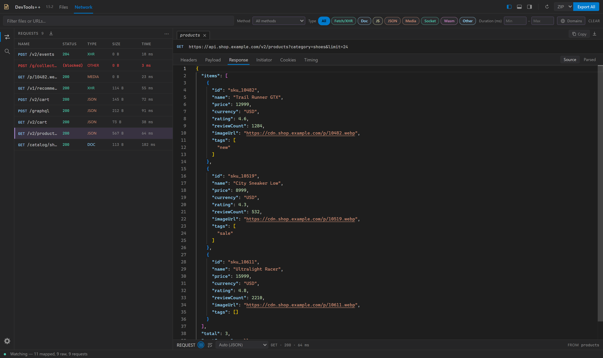
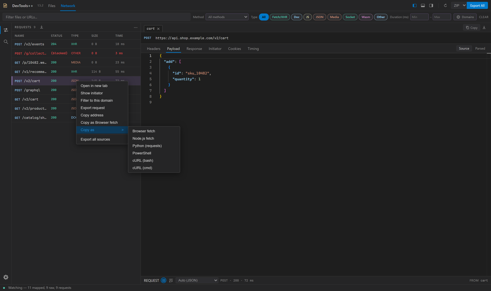
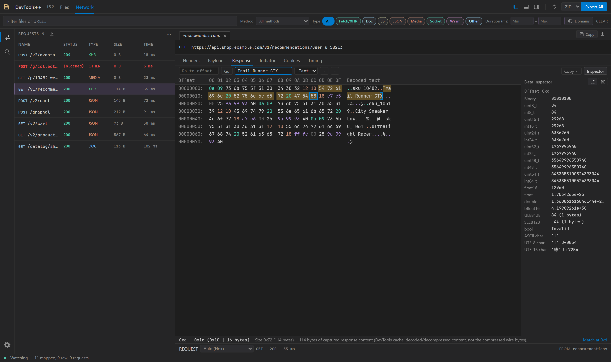

# Network requests

Inspect captured requests in a newest-first list with a separate detail view.

## Filters

The filter bar holds the text filter, **Method**, resource **Type** pills, and minimum or maximum **Duration**. **Clear** resets all of them, including the domain.

**Domains** sits at the right end of the bar because it is used less often. It opens a popover with a search box and a list of captured domains with request counts; choose one, or **All domains** to remove the filter. Use the arrow keys and Enter in the list, Escape to close it. While a domain is selected, the button turns to the accent color and a chip beside it (for example `api.github.com x`) names the domain and removes the filter in one click. A selected domain stays listed even when no captured request uses it.

## List and selection

Files and Network keep independent list selections. Changing filters keeps a matching selected request highlighted and brings it into view.

Failed and blocked requests appear in red, with the captured error available on hover. HTTP error status codes are also red. A missing status alone is not treated as a failure.

Click selects one request and opens its detail. Ctrl/Cmd-click toggles a request and Shift-click selects the range from the last anchor, in the visible (filtered, sorted) order. Selection for batch actions is independent of the detail selection: the detail view keeps showing the request you opened.

Right-click a request for **Open in new tab**, **Show initiator** (see [Initiator](#initiator)), **Filter to this domain**, **Copy address**, or **Copy as...** replay code (see [Copy as code](#copy-as-code)). When several requests are selected, actions that support batches apply to all of them in visible order, joined into one result.

## Copy as code

**Copy as** generates a request replay for the selected request(s):

- Browser fetch (`fetch(...)`)
- Node fetch
- Python, using requests (default) or httpx, chosen with the [Python library](settings.md#python-library) setting
- PowerShell (`Invoke-WebRequest`)
- cURL for bash or cmd

Choose the [quick copy format](settings.md#default-copy-as-format), the [Python library](settings.md#python-library), [replay line width](settings.md#replay-line-width), and how Python writes [embedded JSON](settings.md#embedded-json-in-python) in **Settings > Network**. The line width wraps URLs, raw bodies, and structures; each header and each string value inside a JSON or form structure stays on one line, however long. Python snippets assume the chosen package, and `json` for JSON text bodies, are already imported. Binary bodies use `bytes.fromhex(...)`; JSON and form arguments are used only when their serialization preserves the captured data.

A JSON object or array body is written as a readable structure when re-serializing it reproduces the captured bytes exactly. Python passes it as `json=` only for JSON content types. Other content types, such as the `text/plain` used by some analytics beacons, keep their Content-Type and send `json.dumps(...)` text in Python or `JSON.stringify(payload)` in fetch.

String values that hold JSON text (starting with `{`, `[`, or `"`) are expanded too, at any depth, when re-serializing them gives the same string. By default Python declares a small `stringify(value)` helper above the request and writes them as `stringify(...)`. [Embedded JSON in Python](settings.md#embedded-json-in-python) can instead bind the same helper inline as `(stringify := lambda v: json.dumps(...))(...)` (Python 3.8 or newer) or write inline `json.dumps(...)` calls. fetch writes them as `JSON.stringify(...)`. Bare values such as `"false"` or `"5651832"` stay strings.

Bodies or values whose spacing, escapes, duplicate keys, or number spellings would change stay as the exact captured text. Python and JavaScript print some numbers differently (for example `1.0` or integers beyond 2^53), so a value can be expanded in one language and kept as text in the other. Every format sends the exact captured bytes.

PowerShell sends a text body as the UTF-8 bytes of a readable string, `[Text.Encoding]::UTF8.GetBytes(...)`, with CR, LF, tab and non-ASCII characters written as escapes so line endings in the script cannot change the body. JSON that PowerShell 7's `ConvertTo-Json -Compress` writes back identically becomes an `[ordered]@{...}` structure; anything else stays text. Binary bodies use base64. PowerShell re-spaces `;` in the Content-Type (`text/plain;charset=UTF-8` is sent as `text/plain; charset=UTF-8`).

cURL for bash passes a text body as one inline `--data-raw '...'` word on a single line, like DevTools' own copy (a `'` is written as `'\''`). A body with a CR, LF, tab, other control or invisible format character uses an ANSI-C `$'...'` word instead, where only those characters (and `!`) are escaped and the rest stays readable. Binary bodies, and text bodies over 24000 bytes (a single command-line argument is size limited), are piped from `printf '%b'` to `--data-binary '@-'`. When the capture has no Content-Type, the snippet adds `--header 'Content-Type:'` so curl does not invent `application/x-www-form-urlencoded`. `--request` appears only when the method is not curl's default for the body.

Limits:

- Browser fetch uses the browser's current cookies and managed headers (such as `Cookie`, `Origin`, and `Host`), which can differ from the capture. Other clients are not subject to browser CORS rules but still need valid credentials.
- Replays use captured body text or binary data. URL-encoded forms can also be rebuilt from captured field pairs. Copy as reports an error when required upload bytes are unavailable.
- DevTools can provide decoded upload text without the original bytes. Copy as refuses lossy, compressed, or non-UTF-8 bodies when exact bytes are unavailable instead of generating a corrupted replay.
- Python requests cannot preserve duplicate headers or some encoded URL spellings. Set the [Python library](settings.md#python-library) to httpx, or use cURL, when those are required. PowerShell also refuses duplicate headers; fetch combines them as its native API requires.
- Structured JSON output for httpx requires version 0.28 or newer.
- cURL for cmd uses a Windows PowerShell launcher to preserve shell-sensitive arguments and binary bodies. Requests exceeding cmd.exe's command length limit need another format.
- `Invoke-WebRequest` output requires PowerShell 7 or newer. The snippet's first line stops with an error in Windows PowerShell 5.1, which would read its escapes differently and send other bytes.

## Initiator

The **Initiator** view shows the synchronous and async frames reported by DevTools. Selecting a frame opens its mapped original source in DevTools++ when a retained source map resolves, or the captured raw script at its generated position. If the file was not captured, the action can open native DevTools Sources instead; that fallback is labelled explicitly. Requests with no captured initiator show an unavailable message.

Jumps to a frame, search result, or definition center the target line in the editor and briefly highlight it, so the location stays visible even with sticky scroll enabled.

Frames from an earlier navigation or reset are marked unavailable rather than linked to a different version of the script.

## Detail views

Selecting a request opens **Headers**, **Payload**, **Preview**, **Response**, **Initiator**, **Cookies**, and **Timing** views, where applicable.

- **Raw** switches headers between parsed and wire-oriented text.
- **Source** shows highlighted, optionally pretty-formatted body text. Choose the body language, including **Hex**, from the footer dropdown; **Auto** picks Hex for binary bodies. When the body text is base64 (for example gRPC-web text mode), **Hex (Base64 decoded)** shows the decoded bytes.
- **Parsed** shows a collapsible JSON tree or HTML/XML document tree.
- **Hex** shows an address column, a byte grid, and ASCII, with a data inspector and a selection status bar.
  - Click, drag, or Shift-click to select bytes; arrows, Page Up/Down, Home/End, and Ctrl+A also move or extend the selection.
  - The data inspector decodes the byte at the cursor as integers (8 to 64 bits), floats (half, single, double, bfloat16), LEB128, bool, and ASCII/UTF-8/UTF-16 characters. Toggle little or big endian.
  - **Go to** (Ctrl+G) jumps to a hex or decimal offset. **Find** (Ctrl+F) searches hex bytes or text.
  - Copy the selection, or the whole body when nothing is selected, as hex, compact hex, a C array, Python `bytes.fromhex(...)`, base64, or ASCII.
- **Preview** displays HTML, SVG, and images in a sandboxed frame with scripts disabled.

JSON payloads support a single document or newline-separated object/array records when every record parses. Pretty formatting and the parsed tree preserve large integer values without changing the captured body.

Hex uses exact captured bytes when available. For clean text, it labels the UTF-8 re-encoding. If DevTools already lost the original binary bytes, it shows an explanation instead of invented values; choose a text language to read the decoded text. Response Hex displays cached, decoded content, not the compressed bytes sent over the network. Payload and Response keep separate language choices.

Use the [keyboard shortcuts](editor.md#keyboard-shortcuts) to move between requests and detail tabs.

## Content loading

Response content is requested from the DevTools cache only when **Response** or **Preview** is opened, or the request is exported. Socket streams retain handshake metadata without reading an unbounded streaming body.

For the data included in saved requests, see [request snapshots](exporting.md#request-snapshots). Capture visibility and navigation behavior are described in [capture and filtering](usage.md).
