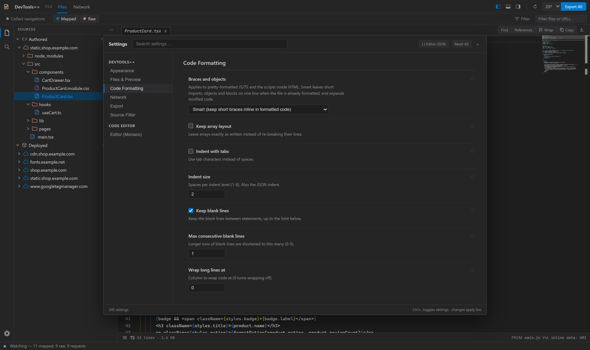

# Settings

Open Settings with the gear button at the bottom of the activity bar, **Ctrl+,**, or by name from the command palette (**Ctrl+Shift+P**). Changes apply immediately and are saved in the extension's local storage, so they carry over to every site you inspect.

- **Search settings** filters by name, description, and section.
- A changed setting is marked as modified; its reset button restores the default. **Reset All** restores every setting.
- **{ } Editor JSON** edits the [Monaco editor options](#editor-monaco) as JSON.



## Appearance

### Color theme

Colors for the whole panel and the code editor: **VS Dark** (default), **DevTools Dark**, **Dark (Navy / Charcoal)**, **VS Light**, **Light**, **High contrast dark**, and **High contrast light**.

### Editor font family

CSS `font-family` list used by the code editor and request bodies. Default: `Cascadia Code, Consolas, monospace`.

### Editor font size

Font size in pixels, 8 to 32. Default: 12.

### Disable smooth scrolling

Scroll the editor instantly instead of animating. Default: off.

## Files & Preview

### Pretty-format previews by default

Open minified JavaScript, CSS, HTML, and JSON already formatted. Toggle a single file with **Shift+Alt+F**. Default: off. How formatted code looks is set in [Code Formatting](#code-formatting).

### TypeScript diagnostics for authored files

Source maps only contain the site's own files, so package imports and path aliases often cannot be resolved.

| Option                 | Shows                                                                 |
| ---------------------- | --------------------------------------------------------------------- |
| **Smart** (default)    | Real type errors; hides errors caused by unresolved imports and names |
| **Syntax errors only** | Syntax errors                                                         |
| **Off**                | Nothing                                                               |

## Code Formatting

How [pretty-formatting](editor.md#editing-and-search) lays out code in previews, request bodies, and formatted exports.

### Braces and objects

Applies to JavaScript, TypeScript, and scripts inside HTML.

| Option                                    | Layout                                                                                                                                           |
| ----------------------------------------- | ------------------------------------------------------------------------------------------------------------------------------------------------ |
| **Smart** (default)                       | Keeps short imports, objects, and blocks on one line in code that is already formatted, such as source-mapped files; fully expands minified code |
| **Always keep inline braces on one line** | Keeps short braces inline everywhere, including minified code                                                                                    |
| **Always expand every block and object**  | One member per line everywhere                                                                                                                   |
| **Expand, with braces on their own line** | Like the above, with each opening brace on a new line                                                                                            |

### Keep array layout

Leave arrays exactly as written instead of re-breaking their lines. Default: off.

### Indent with tabs

Indent with tab characters instead of spaces. Default: off.

### Indent size

Spaces per indent level, 1 to 8. Also used for JSON. Default: 2.

### Keep blank lines

Keep blank lines between statements, up to [Max consecutive blank lines](#max-consecutive-blank-lines). Default: on.

### Max consecutive blank lines

Longer runs of blank lines are shortened to this many, 0 to 5. Default: 1.

### Wrap long lines at

Column to wrap code at; 0 turns wrapping off. Default: 0.

## Network

### Format request & response bodies by default

Pretty-print JSON, form, HTML, and CSS bodies in the [request detail views](network.md#detail-views). The Format toggle in the request footer overrides this for the session. Default: on.

### Default Copy as format

The format used by the quick **Copy as** entry in the request menu: Browser fetch (default), Node.js fetch, Python, PowerShell, cURL (bash), or cURL (cmd). Every format stays available under **Copy as**. See [Copy as code](network.md#copy-as-code).

### Python library

The package **Copy as Python** writes for: **requests** (default) or **httpx**. The request menu shows the choice, for example **Python (requests)**. httpx can also replay duplicate headers and URL spellings that requests would rewrite; with requests, those requests report an error instead of changing the data.

### Replay line width

Preferred width for copied request code: at least 40 columns, with no upper limit. Default: 120. URLs, raw bodies, and structures wrap at this width. Header values and string values inside JSON or form structures always stay on one line, and shell transport commands may exceed it.

### Embedded JSON in Python

How Python replays write string values that hold JSON text, such as analytics fields. Only values that re-serialize to the exact captured bytes are expanded; see [Copy as code](network.md#copy-as-code).

| Option                                         | Output                                                                                                                                                              |
| ---------------------------------------------- | ------------------------------------------------------------------------------------------------------------------------------------------------------------------- |
| **Helper function stringify(...)** (default)   | Declares `def stringify(value): return json.dumps(value, separators=(",", ":"), ensure_ascii=False)` above the request and writes nested values as `stringify(...)` |
| **One-line walrus helper stringify := lambda** | Binds the same helper inline as `(stringify := lambda v: json.dumps(...))(...)`; needs Python 3.8 or newer                                                          |
| **Inline json.dumps(...)**                     | Writes each nested value as its own `json.dumps(..., separators=(",", ":"), ensure_ascii=False)` call                                                               |

```python
def stringify(value):
    return json.dumps(value, separators=(",", ":"), ensure_ascii=False)


response = requests.post(
    url="https://collector.github.com/github/collect",
    headers={
        "Content-Type": "text/plain;charset=UTF-8",
    },
    data=stringify({
        "events": [
            {
                "entries": stringify([{"name": "a.css", "cached": False, "ms": 51.1}]),
                "context": stringify({"react": True}),
            },
        ],
    }),
)
```

## Export

### Pretty-format files on export

Format files with the [Code Formatting](#code-formatting) style when exporting. A file that fails to format is exported unchanged, with a note at the top. Default: off.

### Archive format

Container for Export All, section, and directory exports: **ZIP** (default) or **TAR**. The same choice is next to **Export All** in the toolbar. See [Exporting](exporting.md).

## Source Filter

The same options as the **Filter** popover in the Files toolbar. See [Filter and group files](usage.md#filter-and-group-files) for the rule syntax.

### Apply the source filter

Turn the include and exclude rules on or off without clearing them. Default: on.

### Include

Only show and export files matching one of these comma separated rules. Empty shows everything. Invalid rules are listed and skipped.

### Exclude

Hide files matching any of these rules, even when they match an include rule.

### Group files by

| Option                  | Explorer layout                                                                                      |
| ----------------------- | ---------------------------------------------------------------------------------------------------- |
| **Automatic** (default) | Authored files grouped by domain; Deployed files ungrouped (their paths already start with the host) |
| **Domain**              | One group per domain                                                                                 |
| **File type**           | Groups such as JavaScript, TypeScript, Styles, Images, and Fonts                                     |
| **No grouping**         | No group level                                                                                       |

### Nest files in folders

Turn off to list each group's files by full path instead of as a folder tree. Default: on.

## Editor (Monaco)

Every option of the Monaco code editor, generated from Monaco's own schema and grouped by category, such as Sticky Scroll, minimap, and word wrap. Font family, font size, and smooth scrolling are under [Appearance](#appearance). Boolean editor options can also be toggled from the command palette. **{ } Editor JSON** shows the overrides as JSON for bulk editing. The read-only request and response viewers in the Network detail follow the **Sticky Scroll** options; other Monaco options apply to the file editor only.
