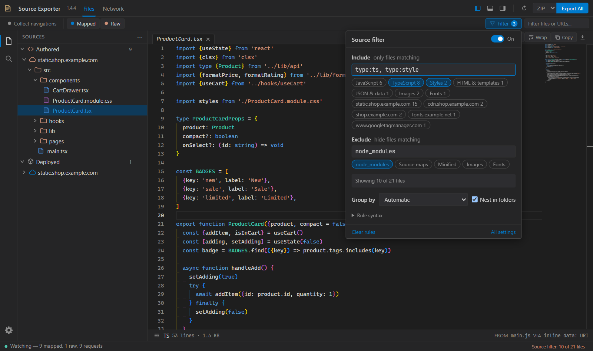

# Capture and filtering

Source Exporter collects files and completed requests from the inspected page while its DevTools panel is visible.

## Source groups

- **Authored**: original files reconstructed from source maps.
- **Deployed**: files served by the website.
- **Requests**: completed network activity, shown newest first rather than as a tree.

Select a file to open it in the [editor](editor.md), or a request to inspect its [details](network.md#detail-views).

## Collect across navigations

Enable **Collect navigations** to retain files while the inspected page reloads or navigates. Later routes and lazy requests add to the same collection until you turn the mode off.

Turning it off keeps the current collection; the next navigation returns to single-page capture. The refresh button always starts a fresh collection.

Capture pauses while another DevTools tab is active. Reload the page with Source Exporter visible if scripts loaded before DevTools opened or while the panel was hidden.

## Pause watching

The dot at the left of the status bar shows whether Source Exporter is watching the page: green while it captures new files, requests, and navigations, hollow while paused. Click it, or right-click it and choose **Pause watching** or **Resume watching**, to toggle. Pausing keeps everything already captured. Resuming catches up with the page, as returning to the panel does, and the refresh button also resumes. The status text keeps the counts current without switching to scan messages; errors and finished [exports](exporting.md) replace it for a few seconds.

## Filter and group files

The **Filter** button in the Files toolbar opens the source filter. Its switch turns the whole filter on or off without clearing your rules, so pausing it takes two clicks. While rules hide files, the button is highlighted with a rule count and the status bar shows how many files remain; click either to edit.

- **Include** keeps only files matching one of the rules. **Exclude** hides matches, and wins over Include.
- Separate rules with commas or new lines. Matching ignores case. An invalid rule is reported and skipped.
- Shortcut chips add or remove common rules: the file types and domains that were captured, and excludes such as `node_modules`, source maps, and minified files.

| Rule                                                 | Matches                                                                                |
| ---------------------------------------------------- | -------------------------------------------------------------------------------------- |
| `*.js, *.html`                                       | File names                                                                             |
| `src/**`, `components/*.tsx`                         | Folder paths; `**` crosses folders, `*` stays in one                                   |
| `github.com`, `react`                                | Text in the path or in a script or source URL                                          |
| `.min.js`                                            | File names ending with it                                                              |
| `domain:cdn.example.com`, `domain:*.site.com`        | A host and its subdomains, or a host pattern                                           |
| `ext:css`, `type:image\|font`                        | Extensions and file types (js, ts, style, html, data, image, font, media, wasm, other) |
| `path:src/components`, `file:Ago`, `url:https://x/*` | Path text, file name text, or a URL pattern                                            |
| `/regex/i`                                           | A regular expression on the path and URLs; no flags means case-insensitive             |

**Group by** chooses the explorer layout: automatic (Authored files by domain), domain, file type, or no grouping. Turn off **Nest in folders** to list each group's files by full path. The same options are under **Settings > [Source Filter](settings.md#source-filter)**, and the rules are saved between sessions.

The filter applies to Authored and Deployed files and their [exports](exporting.md). The Network list has its own [filters](network.md#filters).

## Source-map limits

Reconstructed Authored files need embedded `sourcesContent` in the source map. Path-only entries can appear in the tree but cannot be exported as original source.

Cross-origin maps must be available through the DevTools cache or accessible to the extension's fallback fetch. See [how capture works](architecture.md).
